# DocIntel Extract

**Production-Grade Multimodal Document Intelligence Pipeline** that converts unstructured PDFs, invoices, purchase orders, and receipts into strictly validated Pydantic JSON with **per-field confidence scoring**, **cross-field arithmetic reconciliation**, and a **Human-in-the-Loop (HITL) review queue**.

Runs **100% offline out-of-the-box** using a deterministic PyMuPDF + `pdfplumber` layout & table engine tailored for both **Indonesian** (`Rp`, `PPN 11%`, `NPWP`, `Faktur`, Indonesian dates) and **English** (`USD`, `SGD`, `VAT`, `Invoice`, `PO`, `Receipt`) documents, while exposing pluggable Vision/LLM adapters for **Ollama**, **Google Gemini**, and **OpenAI**.

---

## Architecture

```mermaid
flowchart LR
    A["Input Document<br/>(PDF / PNG / JPG / TXT)"] --> B["Ingestion Layer<br/>(PyMuPDF + pdfplumber + Pillow)"]
    B --> C["Doc-Type Classifier<br/>(Invoice / PO / Receipt)"]
    C --> D{"Extraction Backend"}
    D -->|"local (offline)"| E["Deterministic Layout,<br/>Table & Regex Engine"]
    D -->|"ollama / gemini / openai"| F["Pluggable Vision-LLM<br/>Structured JSON Adapters"]
    E --> G["Strict Pydantic v2<br/>Schema Validation"]
    F --> G
    G --> H["Confidence Scorer &<br/>Arithmetic Reconciliation"]
    H -->|"Pass & Conf >= 0.80"| I["Status: APPROVED<br/>(SQLite Store)"]
    H -->|"Fail or Conf below 0.80"| J["Status: NEEDS_REVIEW<br/>(HITL Review Queue)"]
    J --> K["Human Review UI / API<br/>(Inline Edit + Re-Validate)"]
    K --> L["Status: REVIEWED"]
    I --> M["Batch Export<br/>(JSON / Flattened CSV)"]
    L --> M
```



---

## Key Capabilities

- **Multimodal Document Ingestion (`src/docintel/ingestion.py`)**
  - Dual PDF parsing: `pdfplumber` extracts bordered vector tables while `PyMuPDF` (`fitz`) reconstructs borderless columnar layouts via word bounding-box row grouping.
  - Image inspection via `Pillow` (format/dimensions verification + PNG base64 encoding for Vision-LLM backends) and UTF-8 plain text support.
- **Hybrid Layout + Vision-LLM Extraction (`src/docintel/extractor.py`)**
  - Auto-classifies documents into `invoice`, `purchase_order`, or `receipt` when `doc_type="auto"`.
  - Handles Indonesian (`Rp 1.250.000,00`, `Rp 45.000,-`, `15 Maret 2026`, 15/16-digit `NPWP`, `PPN 11%`, `PB1`) and English (`$1,250.00`, `SGD 3,400.00`, `March 10, 2026`, `VAT`) conventions natively.
  - Clean `httpx`-based Vision-LLM adapters for `ollama`, `gemini`, and `openai` configured purely via `DOCINTEL_*` environment variables.
- **Per-Field Confidence Scoring & Arithmetic Reconciliation (`src/docintel/validator.py`)**
  - Scores every schema field (`0.0–1.0`) using provenance, format validity (ISO dates, NPWP regex, currency ISO codes, required-field presence), and arithmetic agreement.
  - Enforces cross-field financial invariants:
    - $\text{quantity}_i \times \text{unit\_price}_i = \text{line\_total}_i$ for every line item
    - $\sum \text{line\_total}_i = \text{subtotal}$ (Invoices) or $\text{total\_amount}$ (Purchase Orders)
    - $\text{subtotal} + \text{tax\_amount} = \text{total\_amount}$ (Invoices & Receipts)
    - $\text{due\_date} \ge \text{issue\_date}$ chronology verification
  - Automatically routes any document with low confidence, missing required fields, malformed NPWP/dates, or arithmetic mismatch to `NEEDS_REVIEW`.
- **SQLite HITL Review Queue & Batch Export (`src/docintel/review_store.py`)**
  - Persists jobs in WAL-mode SQLite, supports status/doc-type queue filtering, human correction + re-reconciliation (`POST /v1/jobs/{job_id}/review`), and ERP-ready JSON or flattened CSV export.
- **Interactive Dark-Mode Studio UI (`GET /`)**
  - Served directly by FastAPI with zero frontend build step: drag-and-drop uploader, built-in real sample PDF demo buttons, color-coded Field Confidence Visualizer, Arithmetic Audit Trail, Inline HITL Review Editor, and one-click JSON/CSV exports.

---

## Quickstart

### 1. Local Setup (Python 3.11+ — Linux / macOS / Windows)

```bash
git clone <repo-url>
cd docintel-extract
pip install -e ".[dev]"
```

Create your local `.env` configuration:
- **Linux / macOS**: `cp .env.example .env`
- **Windows PowerShell**: `Copy-Item .env.example .env`

```bash
# (Optional) Regenerate the 15 synthetic multi-layout sample PDFs (already included in data/samples/)
python scripts/generate_samples.py

# Launch FastAPI server + Dark-Mode HITL Studio UI
uvicorn docintel.api:app --reload --port 8000
```

> If you prefer installing via `pip install -r requirements.txt` instead of `pip install -e ".[dev]"`, run with `PYTHONPATH=src uvicorn docintel.api:app --reload --port 8000` (Linux/macOS) or `$env:PYTHONPATH="src"; uvicorn docintel.api:app --reload --port 8000` (Windows PowerShell).

Open:
- **Document Intelligence & HITL Studio UI**: `http://127.0.0.1:8000/`
- **Interactive OpenAPI Docs**: `http://127.0.0.1:8000/docs`

### 2. Docker

```bash
docker compose up --build
```

---

## API Usage Examples

### Extract a PDF File (Multipart Upload)

```bash
curl -X POST http://127.0.0.1:8000/v1/extract \
  -F "file=@data/samples/invoice_id_01.pdf" \
  -F "doc_type=auto"
```

### Extract Raw Text (JSON Payload)

```bash
curl -X POST http://127.0.0.1:8000/v1/extract \
  -H "Content-Type: application/json" \
  -d '{
    "filename": "receipt_sample.txt",
    "doc_type": "auto",
    "text": "STRUK PEMBAYARAN\nMerchant: Kopi Nusantara\nNo. Struk: STR-2026-101\nTanggal Transaksi: 18 Maret 2026\nMetode Pembayaran: QRIS\n2 x Kopi Susu Aren @ Rp 25.000  Rp 50.000\nPB1 10%: Rp 5.000\nTotal Bayar: Rp 55.000"
  }'
```

### Submit a Human-in-the-Loop Correction & Approval

```bash
curl -X POST http://127.0.0.1:8000/v1/jobs/<job_id>/review \
  -H "Content-Type: application/json" \
  -d '{
    "data": {"total_amount": 13875000.0},
    "reviewer_notes": "Corrected OCR typo in grand total verified against source PDF",
    "approve": true
  }'
```

### Export Validated Records (JSON or Flattened CSV)

```bash
curl -O "http://127.0.0.1:8000/v1/export?format=csv"
curl -O "http://127.0.0.1:8000/v1/export?format=json"
```

---

## Benchmark Results (Curated Local Benchmark — 15 Synthetic Multi-Layout PDFs)

> **Benchmark Scope & Reproducibility**: The metrics below are measured on the **curated local evaluation dataset of 15 synthetic multi-layout PDFs** (generated via [`scripts/generate_samples.py`](scripts/generate_samples.py)) using the **deterministic/offline layout & table engine (`provider=local`)**. This benchmark runs at zero API cost and is 100% reproducible in CI via `python eval/run_eval.py`. Real-world scanned/noisy PDFs or handwritten invoices should be evaluated with Vision-LLM providers (`python eval/run_eval.py --provider ollama|gemini|openai`).

Evaluated across bordered tables, borderless layouts, and narrow thermal receipts in Indonesian and English (11 clean documents + 4 intentionally degraded/mismatched documents testing missing fields, line-item math errors, and grand-total discrepancies). Full machine-readable output is stored in [`eval/latest_report.json`](eval/latest_report.json).

| Metric | Measured Result (`provider=local`) | Details |
| :--- | ---: | :--- |
| **Doc-Type Classification Accuracy** | **100.00%** | 15 / 15 synthetic PDFs |
| **Field-Level Precision / Recall / F1** | **100.00% / 100.00% / 100.00%** | 122 TP, 0 FP, 0 FN |
| **Line-Item Extraction Precision / Recall / F1** | **100.00% / 100.00% / 100.00%** | 30 TP, 0 FP, 0 FN |
| **Arithmetic Reconciliation Accuracy** | **100.00%** | 15 / 15 checks accurate |
| **HITL Triage Precision / Recall / F1** | **100.00% / 100.00% / 100.00%** | 4/4 degraded flagged, 11/11 clean approved |
| **End-to-End Throughput** | **31.33 docs/sec** | Includes PDF parsing + SQLite WAL commit |
| **End-to-End Latency (Mean / p50 / p95)** | **18.29 ms / 15.38 ms / 30.37 ms** | Measured on local CPU (`provider=local`) |

---

## Switching to Vision-LLM Providers

Update `.env` (or pass `provider` per request) to extract from scanned/photographed documents using Vision-LLMs:

| Provider | Environment Variables | Recommended Model |
| :--- | :--- | :--- |
| `local` (default) | `DOCINTEL_PROVIDER=local` | Deterministic PyMuPDF + `pdfplumber` |
| `ollama` | `DOCINTEL_PROVIDER=ollama`, `DOCINTEL_OLLAMA_BASE_URL=http://localhost:11434`, `DOCINTEL_MODEL=qwen2.5vl:7b` | `qwen2.5vl:7b`, `llama3.2-vision` |
| `gemini` | `DOCINTEL_PROVIDER=gemini`, `DOCINTEL_GEMINI_API_KEY=...`, `DOCINTEL_MODEL=gemini-2.0-flash` | `gemini-2.0-flash` |
| `openai` | `DOCINTEL_PROVIDER=openai`, `DOCINTEL_OPENAI_API_KEY=...`, `DOCINTEL_MODEL=gpt-4o-mini` | `gpt-4o-mini`, `gpt-4o` |

---

## Testing & Code Quality

```bash
# Run unit + FastAPI integration tests
pytest -v

# Run static linting
ruff check src tests eval scripts

# Re-run end-to-end PDF benchmark
python eval/run_eval.py
```

---

## Engineering Trade-Offs & Design Decisions

1. **Deterministic First, Vision-LLM Second**: Calling a Vision-LLM on every clean digital PDF burns latency ($1\text{–}5\text{s}$/page) and token budget. Running PyMuPDF + `pdfplumber` first resolves born-digital financial PDFs in ~15 ms p50 at zero inference cost, while flagging anomalies or scanned images for Vision-LLM escalation or HITL review.
2. **Arithmetic Reconciliation as a Hard Gate**: LLMs and OCR models can output high-probability but subtly wrong digits (e.g., `Rp 14.250.000` instead of `Rp 13.875.000`). Treating cross-field financial invariants as a deterministic gate guarantees zero silent accounting corruption in exported ERP records.
3. **Currency-Aware Rounding Tolerances**: IDR/JPY documents allow `1.0` unit rounding tolerance whereas decimal currencies (`USD`, `EUR`, `SGD`) enforce `0.02`, preventing false-positive review alerts on legitimate tax rounding.
4. **Zero-Build-Step Studio UI + SQLite WAL**: Serving a self-contained HTML/CSS/JS review studio directly from FastAPI with WAL-mode SQLite keeps deployment to a single container while remaining cleanly swappable to PostgreSQL for multi-worker horizontal scaling.

---

## License

MIT License — Copyright (c) 2026 Muhammad Naza Firmansyah. See [LICENSE](LICENSE).
